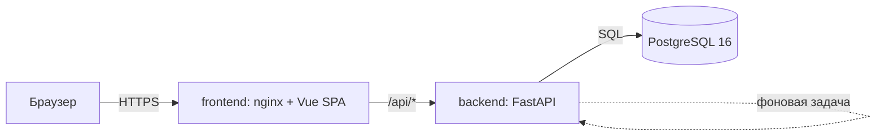
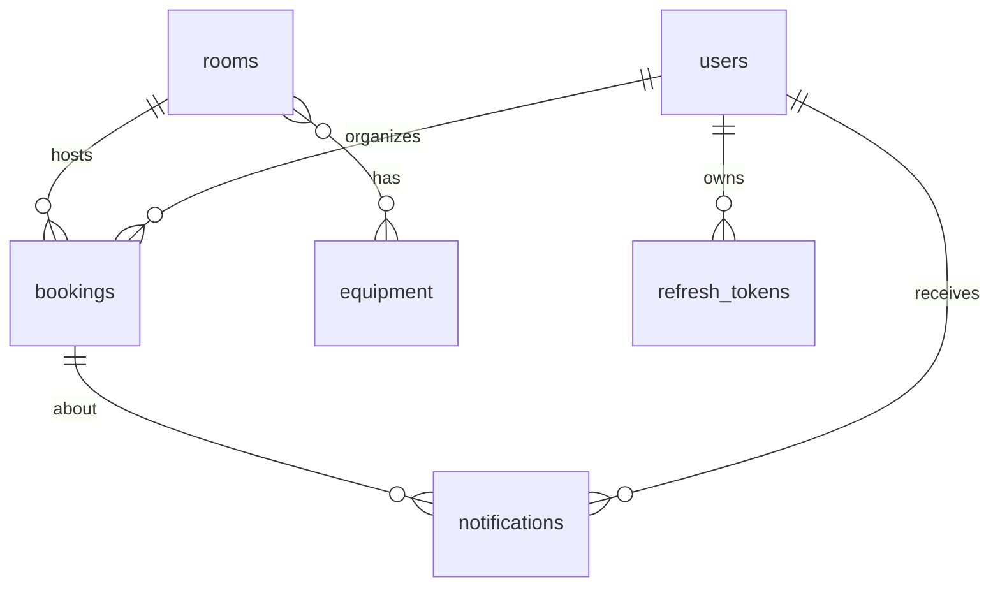
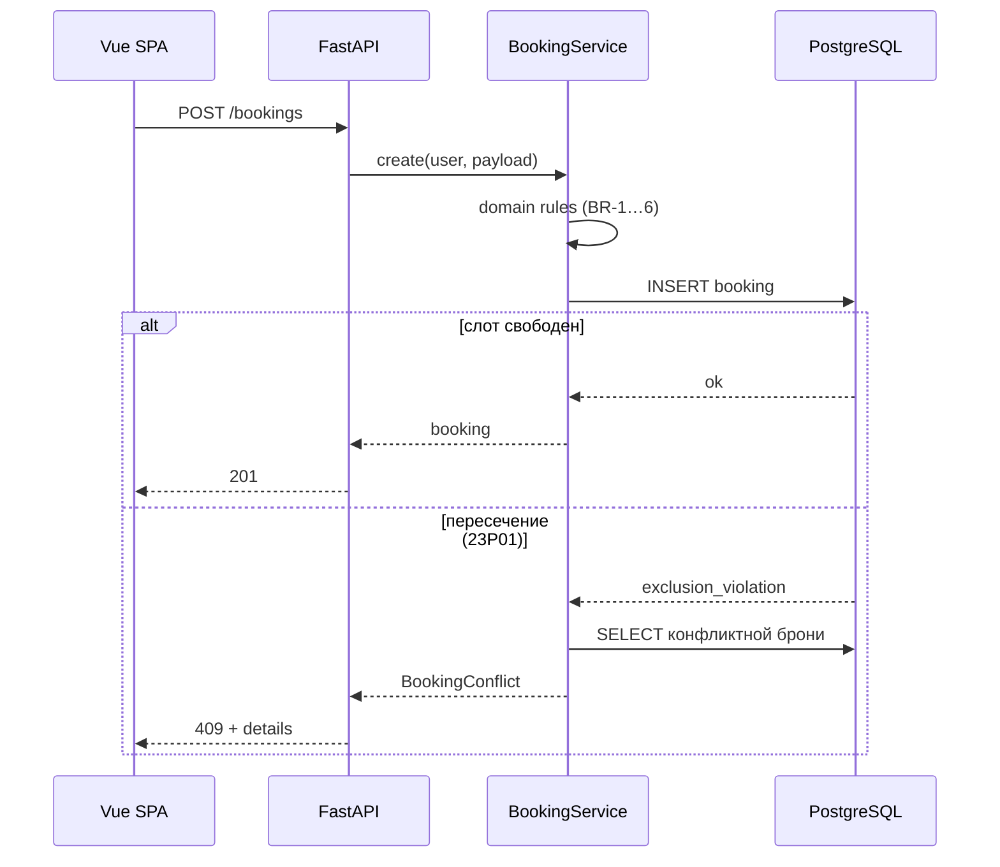
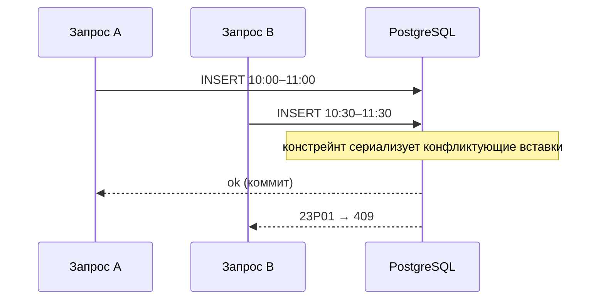
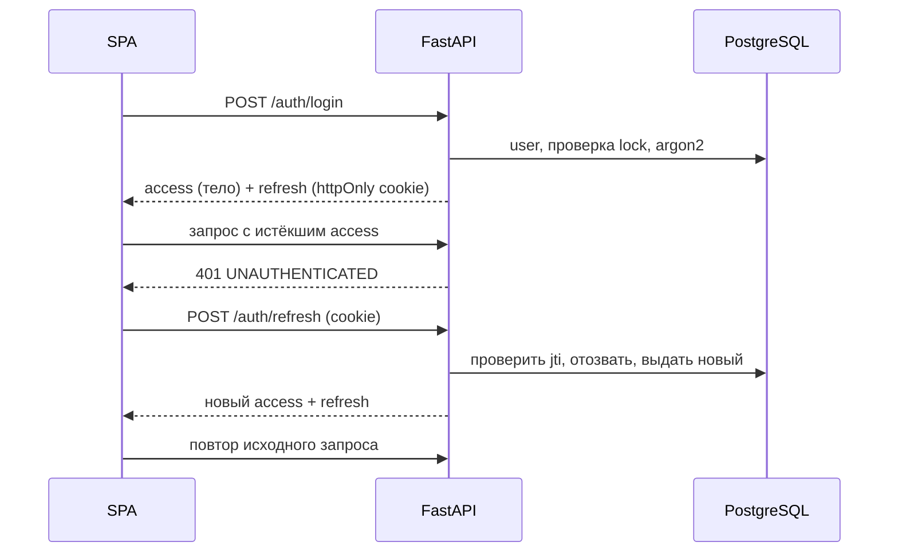

# 2. System Design (v0.2)

Основание: `01-requirements.md` v0.2 (FR, BR, NFR, AC). Допущения по Q1–Q12 из `questions-for-author.md` действуют, пока нет ответов.

## 1. Архитектура

### 1.1 Контейнеры



| Контейнер | Задача |
|---|---|
| `frontend` | Отдаёт статику SPA, проксирует `/api` на бэкенд (один origin — нужен для cookie с refresh-токеном) |
| `backend` | REST API, бизнес-правила, планировщик напоминаний |
| `db` | Данные и гарантия отсутствия пересечений |

`docker compose up` поднимает всё; бэкенд при старте применяет миграции (`alembic upgrade head`) и сид.
В разработке: Vite dev-сервер с proxy на `/api`, Postgres в Docker.

### 1.2 Слои бэкенда

```
backend/app/
├── main.py            # приложение, lifespan (запуск планировщика), обработчики ошибок
├── api/               # роутеры: тонкие, только HTTP ↔ сервис
├── services/          # бизнес-логика: bookings, rooms, users, auth, notifications, stats
├── domain/            # чистые функции без БД: overlaps, rules (BR-1…6), timeutil
├── models.py          # SQLAlchemy 2
├── schemas.py         # Pydantic
├── core/              # config (env), db (сессия), security (хеш, JWT)
└── scheduler.py       # напоминания
```

Правила зависимостей: `api → services → domain/models`; `domain` ничего не импортирует из проекта. Отдельного слоя репозиториев нет: сессия SQLAlchemy — и есть репозиторий.
Синхронные эндпоинты (`def`) и SQLAlchemy 2 с psycopg 3: проще тесты и транзакции, нагрузка малая.

### 1.3 Фронтенд

```
frontend/src/
├── api/        # клиент, типы из OpenAPI (generated)
├── stores/     # Pinia: auth, notifications
├── router/     # маршруты и guard по роли
├── pages/      # экраны
├── components/ # CalendarGrid, BookingForm, RoomCard, NotificationBell …
└── utils/time.ts  # единственное место работы с часовыми поясами
```

## 2. Модель данных



### 2.1 DDL (ориентир для миграции)

```sql
CREATE EXTENSION IF NOT EXISTS btree_gist;

CREATE TYPE user_role AS ENUM ('employee', 'admin');
CREATE TYPE booking_status AS ENUM ('active', 'cancelled');
CREATE TYPE notification_type AS ENUM ('reminder', 'changed', 'cancelled');

CREATE TABLE users (
  id              bigint GENERATED ALWAYS AS IDENTITY PRIMARY KEY,
  full_name       text NOT NULL CHECK (length(full_name) BETWEEN 1 AND 200),
  email           text NOT NULL,
  password_hash   text NOT NULL,
  role            user_role NOT NULL DEFAULT 'employee',
  is_active       boolean NOT NULL DEFAULT true,
  failed_attempts int NOT NULL DEFAULT 0,
  locked_until    timestamptz,
  created_at      timestamptz NOT NULL DEFAULT now()
);
CREATE UNIQUE INDEX users_email_uq ON users (lower(email));

CREATE TABLE rooms (
  id          bigint GENERATED ALWAYS AS IDENTITY PRIMARY KEY,
  name        text NOT NULL UNIQUE,
  location    text,
  capacity    int  NOT NULL CHECK (capacity > 0),
  description text,
  is_active   boolean NOT NULL DEFAULT true
);

CREATE TABLE equipment (
  id   bigint GENERATED ALWAYS AS IDENTITY PRIMARY KEY,
  name text NOT NULL UNIQUE
);

CREATE TABLE room_equipment (
  room_id      bigint NOT NULL REFERENCES rooms(id)     ON DELETE CASCADE,
  equipment_id bigint NOT NULL REFERENCES equipment(id) ON DELETE RESTRICT,
  PRIMARY KEY (room_id, equipment_id)
);

CREATE TABLE bookings (
  id           bigint GENERATED ALWAYS AS IDENTITY PRIMARY KEY,
  room_id      bigint NOT NULL REFERENCES rooms(id),
  organizer_id bigint NOT NULL REFERENCES users(id),
  title        text   NOT NULL CHECK (length(title) BETWEEN 1 AND 200),
  attendees    int    NOT NULL CHECK (attendees >= 1),
  start_at     timestamptz NOT NULL,
  end_at       timestamptz NOT NULL,
  status       booking_status NOT NULL DEFAULT 'active',
  cancelled_by bigint REFERENCES users(id),
  cancelled_at timestamptz,
  created_at   timestamptz NOT NULL DEFAULT now(),
  updated_at   timestamptz NOT NULL DEFAULT now(),
  CONSTRAINT ck_bookings_order    CHECK (start_at < end_at),
  CONSTRAINT ck_bookings_duration CHECK (end_at - start_at BETWEEN interval '15 minutes' AND interval '8 hours'),
  CONSTRAINT ck_bookings_aligned  CHECK (extract(epoch FROM start_at)::bigint % 900 = 0
                                     AND extract(epoch FROM end_at)::bigint   % 900 = 0),
  CONSTRAINT bookings_no_overlap EXCLUDE USING gist (
    room_id WITH =,
    tstzrange(start_at, end_at, '[)') WITH &&
  ) WHERE (status = 'active')
);
CREATE INDEX bookings_organizer_idx ON bookings (organizer_id, start_at DESC);
CREATE INDEX bookings_start_idx     ON bookings (start_at) WHERE status = 'active';

CREATE TABLE notifications (
  id         bigint GENERATED ALWAYS AS IDENTITY PRIMARY KEY,
  user_id    bigint NOT NULL REFERENCES users(id) ON DELETE CASCADE,
  type       notification_type NOT NULL,
  booking_id bigint REFERENCES bookings(id) ON DELETE SET NULL,
  message    text NOT NULL,
  dedupe_key text UNIQUE,
  is_read    boolean NOT NULL DEFAULT false,
  created_at timestamptz NOT NULL DEFAULT now()
);
CREATE INDEX notifications_user_idx ON notifications (user_id, created_at DESC);

CREATE TABLE refresh_tokens (
  id         uuid PRIMARY KEY,
  user_id    bigint NOT NULL REFERENCES users(id) ON DELETE CASCADE,
  expires_at timestamptz NOT NULL,
  revoked_at timestamptz
);
```

### 2.2 Что где проверяется

| Правило | БД | Сервис/домен |
|---|---|---|
| Пересечения (BR-8, BR-9, NFR-1) | **exclusion-констрейнт** (единственный источник истины) | ловит ошибку `23P01`, достаёт конфликтную бронь для ответа |
| BR-1, BR-4 (длительность, кратность 15 мин) | CHECK | дублируется для понятного сообщения |
| BR-2 (не в прошлом), BR-3 (правила изменения) | — | домен |
| BR-5 (рабочие часы, одни сутки) | — (зависит от часового пояса) | домен, зона из конфига |
| BR-6 (участники ≤ вместимость), BR-7 (комната активна) | — | сервис |
| Права (FR-13) | — | зависимости FastAPI + проверка владельца |

Проверка пересечений «заранее» не делается: вставка и есть проверка, что исключает гонку между «проверил» и «записал».

## 3. API

Префикс `/api/v1`. Формат времени: ISO 8601 с offset (`2026-10-01T10:00:00+03:00`). JSON. Все эндпоинты, кроме `login`, `refresh`, `health`, требуют `Authorization: Bearer <access>`.

### 3.1 Эндпоинты

| Метод | Путь | Роль | FR |
|---|---|---|---|
| POST | `/auth/login` | все | 1 |
| POST | `/auth/refresh` | все (cookie) | 2 |
| POST | `/auth/logout` | все | 1 |
| GET | `/me` | вошедший | 1 |
| POST | `/me/password` | вошедший | 5 |
| GET | `/users` | admin | 3 |
| POST | `/users` | admin | 3 |
| PATCH | `/users/{id}` (ФИО, роль, `is_active`) | admin | 4 |
| POST | `/users/{id}/reset-password` | admin | 5 |
| GET | `/rooms` (`min_capacity`, `equipment_ids`, `include_inactive`) | вошедший | 6 |
| GET | `/rooms/available` (`start`, `end`, `min_capacity`, `equipment_ids`) | вошедший | 19 |
| GET | `/rooms/{id}` | вошедший | 6 |
| POST / PATCH | `/rooms`, `/rooms/{id}` | admin | 7 |
| GET | `/equipment` | вошедший | 8 |
| POST / PATCH / DELETE | `/equipment`, `/equipment/{id}` | admin | 8 |
| GET | `/bookings` (`from`, `to` обязательны, ≤ 31 день; `room_id`) | вошедший | 15, 17 |
| GET | `/bookings/my` (`scope=upcoming\|past\|cancelled`) | вошедший | 14 |
| GET | `/bookings/{id}` | вошедший | 18 |
| POST | `/bookings` | вошедший | 9, 10 |
| PATCH | `/bookings/{id}` | владелец / admin | 11, 13 |
| POST | `/bookings/{id}/cancel` | владелец / admin | 12, 13 |
| GET | `/notifications` (`unread_only`, `limit`) | вошедший | 22 |
| GET | `/notifications/unread-count` | вошедший | 22, 23 |
| POST | `/notifications/{id}/read`, `/notifications/read-all` | вошедший | 22 |
| GET | `/stats/rooms`, `/stats/peak-hours`, `/stats/users`, `/stats/summary` (`from`, `to`, `format=csv`) | admin | 24–28 |
| GET | `/health` | все | NFR-7 |

Отмена — `POST /cancel`, а не `DELETE`: это переход состояния, запись остаётся.

### 3.2 Ключевые схемы

```jsonc
// POST /bookings
{ "room_id": 3, "title": "Планёрка", "start_at": "2026-10-01T10:00:00+03:00",
  "end_at": "2026-10-01T11:00:00+03:00", "attendees": 6 }

// Booking (ответ)
{ "id": 42, "room_id": 3, "title": "Планёрка", "start_at": "...", "end_at": "...",
  "attendees": 6, "status": "active", "organizer": { "id": 7, "full_name": "Иванов И." },
  "can_edit": true }   // вычисляется на сервере для текущего пользователя
```

`PATCH /bookings/{id}` принимает любое подмножество `room_id`, `title`, `start_at`, `end_at`, `attendees`.

### 3.3 Формат ошибок

```json
{ "error": { "code": "BOOKING_CONFLICT", "message": "Комната занята в это время",
             "details": { "conflicting_booking": { "id": 40, "title": "Ревью", "start_at": "...", "end_at": "...", "organizer": "Петров П." } } } }
```

| HTTP | code | Когда |
|---|---|---|
| 401 | `INVALID_CREDENTIALS`, `UNAUTHENTICATED` | неверный пароль / нет или просрочен токен |
| 403 | `FORBIDDEN`, `ACCOUNT_DISABLED` | нет прав / пользователь заблокирован |
| 404 | `NOT_FOUND` | объекта нет |
| 409 | `BOOKING_CONFLICT` | пересечение (AC-1, AC-6) |
| 409 | `EMAIL_TAKEN`, `EQUIPMENT_IN_USE`, `SELF_LOCKOUT` | конфликты справочников, BR-13 |
| 422 | `VALIDATION_ERROR` | ошибка формата (Pydantic) |
| 422 | `WRONG_PASSWORD` | неверный текущий пароль при смене (не 401: фронт не должен уходить в refresh) |
| 422 | `INVALID_DURATION`, `NOT_ALIGNED`, `OUTSIDE_WORKING_HOURS`, `BOOKING_IN_PAST`, `CAPACITY_EXCEEDED`, `ROOM_INACTIVE`, `BOOKING_STARTED`, `BOOKING_FINISHED` | нарушения BR-2…7 |
| 429 | `TOO_MANY_ATTEMPTS` | блокировка входа, заголовок `Retry-After` |

## 4. Безопасность

| Тема | Решение |
|---|---|
| Пароли | argon2id (библиотека `argon2-cffi`), политика: минимум 8 символов |
| Access-токен | JWT, 15 минут, во фронтенде хранится в памяти (не в `localStorage`) |
| Refresh-токен | JWT с `jti`, 7 дней, httpOnly cookie `SameSite=Lax`, путь `/api/v1/auth`; ротация при каждом refresh, запись в `refresh_tokens`, отзыв при logout |
| Блокировка пользователя | На каждом запросе пользователь загружается из БД и проверяется `is_active` — блокировка действует сразу, не после истечения токена |
| Подбор пароля | 5 неверных попыток → `locked_until = now + 15 мин`, счётчик в `users` (переживает перезапуск) |
| RBAC | Зависимости `current_user`, `require_admin`; владельца брони проверяет сервис |
| Секреты | `JWT_SECRET`, `DATABASE_URL` из окружения; в репозитории только `.env.example` |
| CORS | Не нужен (один origin через nginx/Vite proxy) |
| Ввод | Pydantic на границе; SQL только через параметры |
| Первый администратор | Создаётся сидом из `ADMIN_EMAIL`/`ADMIN_PASSWORD` |
| Временный пароль | Создание пользователя и сброс возвращают пароль один раз в ответе; хранится только хеш |

## 5. Алгоритмы

### 5.1 Пересечение

```python
def overlaps(a_start, a_end, b_start, b_end) -> bool:
    return a_start < b_end and b_start < a_end   # [start, end)
```

Это эталон для unit-тестов. В БД то же условие задаёт оператор `&&` для `tstzrange(..., '[)')`.

### 5.2 Создание брони

1. Pydantic разбирает и нормализует время в UTC.
2. Домен: BR-1, BR-4 (длительность и кратность 15 минут), BR-5 (локальное время организации через `zoneinfo`: начало ≥ 08:00, конец ≤ 20:00, одни сутки), BR-2 (`start ≥ floor_15(now)`).
3. Сервис: комната существует и активна (BR-7), `attendees ≤ capacity` (BR-6).
4. `INSERT`. Если `IntegrityError` с SQLSTATE `23P01` → откат, запрос конфликтной брони, `409 BOOKING_CONFLICT`.
5. Коммит, ответ 201.

### 5.3 Изменение брони

1. Загрузить бронь `SELECT … FOR UPDATE`. Права: владелец или admin.
2. Если `end_at ≤ now` → `BOOKING_FINISHED`. Если `start_at ≤ now` (идёт) → разрешено только уменьшить `end_at` (остаётся `> now`), иначе `BOOKING_STARTED`.
3. Применить изменения и повторить проверки 5.2 (2–3).
4. `UPDATE`; сама бронь себя не блокирует, потому что констрейнт исключает строку из сравнения с самой собой.
5. Если правил не нарушено и действие выполнил не владелец → уведомление `changed` в той же транзакции.

Отмена: те же проверки прав и `BOOKING_FINISHED`, затем `status='cancelled'`, `cancelled_by`, `cancelled_at`; уведомление `cancelled`, если отменил не владелец (BR-12).

### 5.4 Поиск свободных комнат

```sql
SELECT r.*
FROM rooms r
WHERE r.is_active
  AND r.capacity >= :min_capacity
  AND NOT EXISTS (
        SELECT 1 FROM bookings b
        WHERE b.room_id = r.id AND b.status = 'active'
          AND tstzrange(b.start_at, b.end_at, '[)') && tstzrange(:start, :end, '[)'))
  AND (:n_equipment = 0 OR (
        SELECT count(*) FROM room_equipment re
        WHERE re.room_id = r.id AND re.equipment_id = ANY(:equipment_ids)) = :n_equipment)
ORDER BY r.capacity, r.name;
```

Индекс `bookings_no_overlap` (gist по `room_id` и диапазону) обслуживает `NOT EXISTS`. Сортировка по вместимости показывает самые подходящие комнаты первыми.

### 5.5 Статистика

Период `[from, to]` — локальные даты организации; границы переводятся в UTC. Рабочий день: 12 часов = 720 минут (константа из конфига).

- **Загрузка комнаты:** `booked_minutes / (720 × days)`, где `booked_minutes` — сумма пересечения активных броней с периодом. Брони внутри рабочих часов гарантированы BR-5. В период могут входить будущие дни, тогда это «запланированная загрузка»; в интерфейсе подпись «занято / доступно».
- **Пиковые часы:** для каждой брони разворачиваются часовые слоты `generate_series` в локальной зоне; результат — матрица `isodow (1–7) × hour (8–19)` со значением `booked_minutes`, `bookings_count`.
- **Пользователи:** по организатору `total`, `active`, `cancelled`, `hours` (активные), `cancel_rate = cancelled / total`. Топ по часам.
- **Сводка:** общее число броней, доля отмен, средняя длительность.

Допущение: все дни периода считаются рабочими (Q2). При ответе автора формула получает список рабочих дней.

CSV: тот же результат, `Content-Type: text/csv; charset=utf-8` с BOM для корректного открытия в Excel, разделитель `;`.

### 5.6 Время

- В БД и внутри домена — только aware `datetime` в UTC.
- Локальная зона организации `ORG_TIMEZONE` (по умолчанию `Europe/Moscow`) используется в трёх местах: BR-5, статистика, текст уведомлений. Везде через `zoneinfo`.
- Фронтенд показывает время в зоне организации (а не браузера), чтобы все видели одинаковую сетку. Единственный модуль — `utils/time.ts`.

## 6. Планировщик напоминаний

Фоновая задача `asyncio` в `lifespan` FastAPI; каждые 30 секунд выполняет один идемпотентный SQL:

```sql
INSERT INTO notifications (user_id, type, booking_id, message, dedupe_key)
SELECT b.organizer_id, 'reminder', b.id,
       'Скоро начнётся: ' || b.title || ', ' || r.name || ', ' ||
       to_char(b.start_at AT TIME ZONE :tz, 'HH24:MI'),
       'reminder:' || b.id || ':' || extract(epoch FROM b.start_at)::bigint
FROM bookings b JOIN rooms r ON r.id = b.room_id
WHERE b.status = 'active'
  AND b.start_at > now()
  AND b.start_at <= now() + interval '15 minutes'
ON CONFLICT (dedupe_key) DO NOTHING;
```

- **Без дублей:** уникальный `dedupe_key` (бронь + момент начала). Повторный запуск, перезапуск сервиса и несколько инстансов безопасны (NFR-6).
- **Перенос брони:** новое время даёт новый ключ — напоминание придёт по новому времени (BR-11).
- **Отмена:** отменённые брони не попадают в выборку.
- **Бронь создана менее чем за 15 минут до начала:** напоминание приходит на ближайшем тике.
- Погрешность — до 30 секунд.

Ограничение: пока сервис остановлен, напоминания не создаются; после старта придут те, у кого начало ещё впереди.

## 7. Диаграммы последовательностей

### 7.1 Создание брони и конфликт



### 7.2 Гонка двух запросов



Оба запроса могли «увидеть свободный слот» на уровне приложения, но решает БД.

### 7.3 Вход и обновление токена



## 8. Интерфейс

### 8.1 Карта экранов

| Маршрут | Экран | Роль | FR |
|---|---|---|---|
| `/login` | Вход | все | 1 |
| `/` | Календарь «комнаты × день» (главный) | все | 15, 16, 18 |
| `/rooms` | Список комнат с фильтрами | все | 6 |
| `/rooms/:id` | Комната: описание и календарь «неделя» | все | 17 |
| `/search` | Поиск свободных комнат | все | 19 |
| `/my` | Мои брони (вкладки: предстоящие, прошедшие, отменённые) | все | 14 |
| `/admin/rooms` | Комнаты и оборудование | admin | 7, 8 |
| `/admin/users` | Пользователи | admin | 3–5 |
| `/admin/stats` | Статистика и экспорт | admin | 24–28 |

Глобально: шапка с навигацией, колокольчик уведомлений (панель-выпадашка, опрос `unread-count` раз в 30 секунд), меню пользователя.

### 8.2 Календарь «комнаты × день»

```
[◀] [Сегодня] [▶]  Чт, 1 октября 2026         Мин. вместимость: [ ]  
        Переговорная 1   Переговорная 2   Большой зал
08:00 ┃                 ┃                ┃
08:15 ┃                 ┃                ┃
09:00 ┃ ▓ Планёрка ▓    ┃                ┃  ← своя бронь (акцент)
10:00 ┃ ▒ Ревью ▒       ┃  ░ выбор ░     ┃  ← чужая (нейтральная), свободный слот при выделении
 …    ┃                 ┃                ┃
20:00 ┗━━━━━━━━━━━━━━━━━┻━━━━━━━━━━━━━━━┻━━━━━
```

- Колонки — активные комнаты, строки — по 15 минут (высота строки фиксирована), сетка 08:00–20:00.
- Выделение свободных клеток мышью или клавишей → форма брони с предзаполненными комнатой и временем (FR-16). Занятые клетки не выделяются.
- Клик по своей брони — форма изменения и кнопка «Отменить»; по чужой — карточка только для чтения (тема, организатор, время); администратору доступны те же действия, что для своей.
- Красная линия «сейчас», прошедшее время затемнено и недоступно для выделения.
- Список броней дня загружается одним запросом `GET /bookings?from&to`; после создания/изменения перезагружается.

### 8.3 Форма брони

Поля: комната (select), дата, начало, конец (селекты с шагом 15 минут в границах 08:00–20:00), тема, число участников. Ошибка `BOOKING_CONFLICT` показывается блоком «Занято: <тема>, <время>, <организатор>» с кнопкой «Показать в календаре». Ошибки `422` подсвечивают поле по `code`. Клиентская проверка — только подсказка (NFR-9).

### 8.4 Остальное

- **Комната/неделя:** 7 колонок, 15-минутные строки, только брони этой комнаты; тот же компонент `CalendarGrid` с параметром `columns`.
- **Поиск:** дата, начало, конец, мин. вместимость, чекбоксы оборудования → карточки комнат с кнопкой «Забронировать» (открывает форму).
- **Статистика:** вкладки «Комнаты» (таблица + столбчатая диаграмма загрузки), «Пиковые часы» (теплокарта день × час), «Пользователи» (таблица + доля отмен), фильтр периода, кнопка «Скачать CSV».
- **Состояния:** загрузка, пусто, ошибка сети — у каждого списка.

## 9. Соответствие требованиям

| Требования | Где реализовано (раздел) |
|---|---|
| FR-1…5 | 3, 4, 7.3 |
| FR-6…8 | 3, 8.1 |
| FR-9…14 | 2.2, 3, 5.2, 5.3, 7.1 |
| FR-15…19 | 3, 5.4, 8.2–8.4 |
| FR-20…23 | 5.3, 6, 8.1 |
| FR-24…28 | 5.5, 8.4 |
| NFR-1 | 2.1, 2.2, 7.2 |
| NFR-2 | 5.6 |
| NFR-3, 4 | 4 |
| NFR-6 | 6 |
| NFR-7 | 1.1 |
| NFR-11 | 1.3, ADR-1 |

## 10. Записи решений (ADR)

| # | Решение | Причина | Цена |
|---|---|---|---|
| ADR-1 | Две кодовые базы; типы фронтенда генерируются из OpenAPI | Чёткая граница, независимая проверка, выбор пользователя | Шаг генерации типов в сборке |
| ADR-2 | PostgreSQL с exclusion-констрейнтом | Гарантия без блокировок в коде, корректна при гонках | Нужен Docker/Postgres; `btree_gist` |
| ADR-3 | Полуоткрытые интервалы `[start, end)` | Встречи встык не конфликтуют | — |
| ADR-4 | Отмена = статус, `POST /cancel` | История для статистики; отмена — переход состояния | Фильтр `status` в запросах |
| ADR-5 | Без слоя репозиториев | Сессия SQLAlchemy уже абстракция; меньше кода | Сервисы знают про SQLAlchemy |
| ADR-6 | Вставка как проверка пересечений (без предпроверки) | Нет окна гонки, меньше кода | Нужен второй запрос за деталями конфликта |
| ADR-7 | Access в памяти + refresh в httpOnly cookie; пользователь грузится на каждый запрос | Защита от XSS-кражи токена и мгновенная блокировка | Один запрос к БД на вызов |
| ADR-8 | Хранение в UTC, показ в зоне организации | Одна сетка для всех, корректно при смене DST | Зона из конфига, не из браузера |
| ADR-9 | Планировщик в процессе бэкенда, идемпотентный SQL с `dedupe_key` | Без брокера и отдельного сервиса; безопасен при нескольких инстансах | Точность ±30 с; пока сервис выключен, напоминаний нет |
| ADR-10 | Уведомления через опрос раз в 30 с | Просто; хватает для напоминаний | Задержка до 30 с; WebSocket/SSE — при необходимости |
| ADR-11 | Свой компонент календарной сетки, без FullCalendar | Ресурсный вид FullCalendar, по-видимому, платный (не проверено); нужна лишь сетка «колонки × 15 минут» | Свой код на CSS Grid |

## 11. Проверка рисков (выполнена 2026-09-30)

Стенд: PostgreSQL 16.15 (Docker), SQLAlchemy 2.1.1, psycopg 3.3.6, Alembic 1.20.0, argon2-cffi 25.1.0. DDL и SQL брались из этого документа дословно.

| Утверждение / риск | Результат | Вывод |
|---|---|---|
| DDL из п. 2.1 выполняется | ✔ | — |
| Пересечение, вложенный интервал → `23P01`; встык, другая комната, `cancelled` → успех; отмена освобождает слот; `UPDATE` без смены времени проходит | ✔ | Соответствует AC-1…AC-5 |
| CHECK: 5 минут, 9 часов, не кратно 15, `start ≥ end` → `23514` | ✔ | Безымянные CHECK получали имена `bookings_check1/2`; в DDL добавлены явные имена `ck_bookings_*` |
| `+03:00` и UTC эквивалентны в констрейнте | ✔ | — |
| `btree_gist` нужен: без него `42704 no default operator class for gist` | ✔ | Расширение обязательно в миграции. По документации PostgreSQL оно *trusted*: владелец БД может установить без суперпользователя |
| `WHERE` и выражения в `EXCLUDE` допустимы | ✔ (документация PostgreSQL 16) | — |
| `ExcludeConstraint` с `func.tstzrange(...)` и `where=` в SQLAlchemy даёт нужный DDL | ✔ | — |
| Alembic autogenerate включает `ExcludeConstraint` в миграцию | ✔ | Ручная SQL-миграция не нужна |
| SQLSTATE из `IntegrityError.orig.sqlstate`, имя констрейнта из `.orig.diag.constraint_name` | ✔ (`23P01`, `bookings_no_overlap`) | Обработчик ошибок опирается на это |
| Гонка INSERT, 8 потоков на один слот | ✔: 1 `ok`, 7 `23P01` | NFR-1, AC-6 |
| Гонка UPDATE, две брони в один слот (`FOR UPDATE`) | ✔: 1 `ok`, 1 `23P01` | — |
| Поиск свободных (п. 5.4): занятая комната исключена, отменённая не блокирует, фильтры вместимости и оборудования, встык | ✔ | AC-7 |
| Напоминания (п. 6): одно уведомление, повторный тик не дублирует, отмена → 0, перенос внутри окна → новое напоминание | ✔ | BR-11, FR-20. Через `sqlalchemy.text()` SQL выполняется без экранирования |
| Пиковые часы в локальной зоне и загрузка (6 ч из 12 → 50%) | ✔ | AC-16 |
| argon2id: хеш и проверка | ✔ | — |
| FullCalendar: Timeline и Vertical Resource view только в Premium (от $480) | ✔ (fullcalendar.io/pricing) | ADR-11 подтверждён: свой компонент |
| `openapi-typescript` генерирует типы из OpenAPI 3.0/3.1, есть парный `openapi-fetch` | ✔ (openapi-ts.dev) | NFR-11 реализуем |

### Найденные ловушки для реализации

1. Тип колонки времени в SQLAlchemy: `Mapped[datetime]` без `DateTime(timezone=True)` создаёт `TIMESTAMP WITHOUT TIME ZONE`. Использовать `DateTime(timezone=True)` везде.
2. Безымянные CHECK получают имена вида `bookings_check1`. Имена заданы явно, чтобы сопоставлять ошибки с правилами.
3. `23514` (нарушение CHECK) не должен доходить до пользователя: домен проверяет BR-1 и BR-4 раньше и возвращает понятный `422`.

### Не проверено

| Что | Почему |
|---|---|
| Поведение `EXCLUDE` и `FOR UPDATE` при высокой конкуренции и `SERIALIZABLE` | Для прототипа достаточно проверенных гонок; нагрузочные тесты вне скоупа |
| Работа нескольких инстансов планировщика | Безопасность следует из `ON CONFLICT`, но параллельно не запускалось |
| Тайминг планировщика в реальном `asyncio`-цикле | Проверялся только SQL |
| Смена летнего времени | Часовой пояс по умолчанию (`Europe/Moscow`) без DST; запросы статистики со сдвигом не тестировались |
| Ответы автора кейса Q1–Q12 | Влияют на модель: местоположение → сущности, статус `pending`, рабочие дни |
