<div align="center">

[Министерство / ведомство — заполнить]

[Полное название вуза — заполнить]

[Институт / факультет — заполнить]
[Кафедра — заполнить]

<br>

**ОТЧЁТ**

**о выполнении [тип работы — заполнить]**

**«Веб-приложение для бронирования переговорных комнат»**

<br>

</div>

| | |
|---|---|
| Выполнил: магистрант группы [группа — заполнить] | Александр [фамилия, инициалы — заполнить] |
| Руководитель: [должность, учёная степень — заполнить] | [ФИО — заполнить] |

<div align="center">

<br>

[Город — заполнить] 2026

</div>

---

## Содержание

- [Введение](#введение)
- [1. Анализ и требования](#1-анализ-и-требования)
- [2. Проектирование системы](#2-проектирование-системы)
- [3. Реализация](#3-реализация)
- [4. Тестирование](#4-тестирование)
- [Заключение](#заключение)
- [Список использованных источников](#список-использованных-источников)
- [Приложение А. Инструкция пользователя](#приложение-а-инструкция-пользователя)
- [Приложение Б. Интерфейс](#приложение-б-интерфейс)

---


## Введение

В организациях с несколькими переговорными комнатами бронирование часто ведут в общих таблицах или мессенджерах. Типичные проблемы такого подхода — двойные брони одной комнаты, отсутствие актуальной картины занятости и невозможность оценить, насколько эффективно используются помещения.

**Цель работы** — спроектировать и реализовать прототип веб-приложения для бронирования переговорных комнат, в котором пересечение встреч в одной комнате исключено гарантированно, в том числе при одновременных запросах.

**Задачи:**

1. Собрать и формализовать требования: сценарии, функциональные и нефункциональные требования, бизнес-правила, критерии приёмки.
2. Спроектировать архитектуру, модель данных, API и интерфейс; проверить ключевые проектные риски на реальной СУБД.
3. Реализовать серверную часть (REST API) и клиентское одностраничное приложение.
4. Покрыть систему автоматическими тестами и провести приёмку по критериям.

**Объект** — процесс бронирования общих помещений в организации. **Предмет** — методы обеспечения целостности расписания и программная реализация системы бронирования.

Главный инвариант системы: **в одной комнате нет двух активных броней с пересекающимися интервалами времени**. Он обеспечивается ограничением исключения (exclusion constraint) PostgreSQL, а не только проверкой в коде приложения.

Результат — работающий прототип: бэкенд на FastAPI и PostgreSQL, фронтенд на Vue 3; 65 автотестов бэкенда и 6 фронтенда; все 17 критериев приёмки выполнены.

## 1. Анализ и требования

Полная спецификация требований (версия 0.2, утверждена 30.09.2026) приведена в `docs/01-requirements.md`. Ниже — основные положения.

### 1.1. Цель и границы системы

Система позволяет просматривать комнаты, создавать, изменять и отменять брони, видеть календарь занятости, искать свободные комнаты на интервал, получать уведомления и анализировать использование помещений.

| В границах | Вне границ |
|---|---|
| Вход по email и паролю, две роли | Самостоятельная регистрация, сброс пароля по почте |
| Справочники: пользователи, комнаты, оборудование | Иерархия помещений (здания, этажи) |
| Брони, календарь, поиск свободных комнат | Повторяющиеся встречи, перетаскивание броней |
| Уведомления внутри приложения | Email, Telegram, интеграция с внешними календарями (.ics) |
| Статистика и экспорт в CSV | Отчёты в .docx/.xlsx, история изменений брони |

Границы согласованы с заказчиком; исключённые возможности перечислены как направления развития.

### 1.2. Акторы и права

Выделены две роли. **Сотрудник** бронирует комнаты и управляет своими бронями. **Администратор** дополнительно ведёт справочники, управляет пользователями, может изменять и отменять чужие брони и видит статистику.

| Действие | Сотрудник | Администратор |
|---|---|---|
| Просмотр комнат, календаря, поиск | ✔ | ✔ |
| Создание брони; изменение и отмена своей | ✔ | ✔ |
| Изменение и отмена чужой брони | ✘ (403) | ✔ |
| Управление комнатами, оборудованием, пользователями | ✘ | ✔ |
| Статистика | ✘ | ✔ |

Аккаунты создаёт администратор. Права проверяются на сервере при каждом запросе; интерфейс лишь скрывает недоступные действия.

### 1.3. Жизненный цикл брони

У брони два хранимых статуса: `active` и `cancelled`. Создание переводит бронь в `active`; изменение сохраняет статус, но повторно проверяет все правила; отмена — конечный переход в `cancelled`. Отменённая запись не удаляется: она нужна для статистики (доля отмен). Состояния «идёт сейчас» и «прошла» не хранятся, а вычисляются по текущему времени.

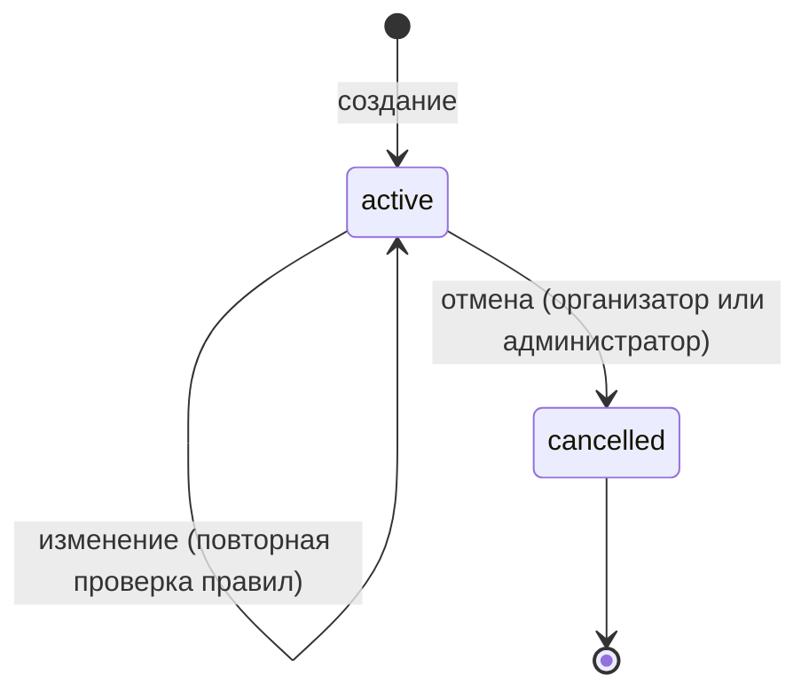

_Рисунок 1 — Жизненный цикл брони_

### 1.4. Функциональные требования и бизнес-правила

Сформулировано 17 пользовательских сценариев (US-1…US-17) и 28 функциональных требований (FR-1…FR-28) в шести модулях: аутентификация и пользователи, комнаты, бронирование, календарь и поиск, уведомления, статистика. Каждому требованию назначен приоритет (обязательно / желательно / при наличии времени) и связь со сценарием; матрица трассируемости «модуль → US → FR → AC» приведена в спецификации.

Ключевые бизнес-правила:

| ID | Правило |
|---|---|
| BR-2 | Бронь в прошлом создать нельзя |
| BR-3 | Начавшуюся бронь можно только сократить или отменить; закончившуюся — нельзя менять |
| BR-4 | Длительность от 15 минут до 8 часов, границы кратны 15 минутам |
| BR-5 | Бронь целиком в рабочих часах 08:00–20:00 и в пределах одних суток |
| BR-6 | Участников не больше вместимости комнаты |
| BR-8 | Отменённая бронь не участвует в проверке пересечений |
| BR-9 | Интервалы полуоткрытые `[start, end)`: встречи 10:00–11:00 и 11:00–12:00 не конфликтуют |
| BR-12 | Уведомление об изменении не создаётся, если действие выполнил сам организатор |
| BR-13 | Администратор не может заблокировать или разжаловать сам себя |

Полуоткрытые интервалы (BR-9) выбраны сознательно: при закрытых интервалах встречи «встык» считались бы пересекающимися, что противоречит ожиданиям пользователей.

### 1.5. Нефункциональные требования

Определено 11 нефункциональных требований. Наиболее значимые для архитектуры:

- **NFR-1, целостность** — пересечения невозможны даже при параллельных запросах, гарантия на уровне БД;
- **NFR-2, время** — хранение в UTC, в API — ISO 8601 со смещением, в интерфейсе — часовой пояс организации;
- **NFR-3, NFR-4, безопасность** — хеширование паролей, токены с ограниченным сроком жизни, ограничение попыток входа;
- **NFR-6, надёжность** — напоминания не дублируются и переживают перезапуск сервиса;
- **NFR-11, сопровождаемость** — типы фронтенда генерируются из контракта API, расхождение ломает сборку.

### 1.6. Критерии приёмки, допущения и открытые вопросы

Для проверки результата составлено 17 критериев приёмки (AC-1…AC-17) в формате «сценарий → ожидаемый результат», каждый связан с требованием. Результаты их проверки приведены в разделе 4.3.

Часть вопросов к автору кейса (Q1–Q12, `docs/questions-for-author.md`) осталась без ответа. Работа велась на явных допущениях: помещения — плоский список с текстовым полем местоположения; один часовой пояс `Europe/Moscow`; бронирование возможно в любой день; брони подтверждаются сразу, без согласования; статистика доступна только администратору. Модель данных оставляет возможность изменить эти допущения без перестройки системы.

## 2. Проектирование системы

Проектная документация — `docs/02-design.md`.

### 2.1. Выбор стека

| Слой | Технология | Обоснование |
|---|---|---|
| Бэкенд | Python 3.12, FastAPI, SQLAlchemy 2, Alembic, Pydantic | Автоматическая генерация OpenAPI, строгая валидация входных данных, зрелый ORM и миграции |
| СУБД | PostgreSQL 16 | Ограничения исключения и диапазонные типы позволяют запретить пересечения на уровне БД |
| Фронтенд | Vue 3, Vite, TypeScript, Pinia, vue-router | Основной стек разработчика; быстрая сборка; строгая типизация |
| Контракт | openapi-typescript, openapi-fetch | Типы клиента выводятся из схемы API, а не пишутся вручную |
| Тесты | pytest, Vitest | Стандартные инструменты для каждой части |

Решающим был выбор СУБД. SQLite проще в развёртывании, но не поддерживает ограничения исключения, поэтому защиту от гонок пришлось бы строить на блокировках в коде приложения.

### 2.2. Архитектура

Система состоит из трёх частей: одностраничное приложение (SPA) в браузере, REST API на FastAPI и PostgreSQL. В режиме разработки SPA обслуживает Vite, который проксирует запросы `/api` на бэкенд; таким образом фронтенд и API работают с одного источника (origin), что нужно для cookie с refresh-токеном и избавляет от настройки CORS.

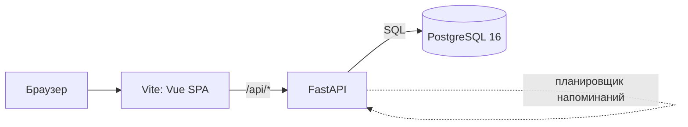

_Рисунок 2 — Компоненты системы (режим разработки)_

Бэкенд разбит на слои с однонаправленными зависимостями `api → services → domain/models`:

| Слой | Ответственность |
|---|---|
| `api/` | Тонкие роутеры: разбор HTTP-запроса, вызов сервиса, ответ |
| `services/` | Бизнес-логика: брони, комнаты, пользователи, аутентификация, уведомления, статистика |
| `domain/` | Чистые функции без доступа к БД: пересечение интервалов, бизнес-правила BR-1…BR-7 |
| `models.py`, `schemas.py` | Модели SQLAlchemy и схемы Pydantic |
| `core/` | Конфигурация, сессия БД, безопасность, единый формат ошибок |
| `scheduler.py` | Фоновая задача напоминаний |

Отдельный слой репозиториев не вводился: сессия SQLAlchemy уже служит абстракцией доступа к данным, а дополнительная обёртка увеличила бы объём кода без пользы для прототипа.

### 2.3. Модель данных и защита от пересечений

Модель включает таблицы `users`, `rooms`, `equipment`, `room_equipment` (связь «многие ко многим»), `bookings`, `notifications` и `refresh_tokens`. Все моменты времени хранятся в типе `timestamptz` (UTC).

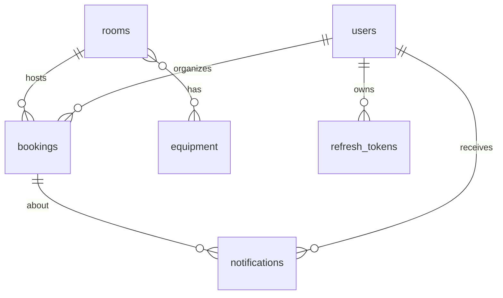

_Рисунок 3 — Модель данных_

Целостность расписания обеспечивает ограничение исключения:

```sql
CONSTRAINT bookings_no_overlap EXCLUDE USING gist (
  room_id WITH =,
  tstzrange(start_at, end_at, '[)') WITH &&
) WHERE (status = 'active')
```

Ограничение запрещает две строки с одинаковой комнатой и пересекающимися (`&&`) полуоткрытыми диапазонами. Условие `WHERE` исключает из проверки отменённые брони (BR-8). Для сочетания оператора `=` по `bigint` с GiST-индексом требуется расширение `btree_gist`. Дополнительные CHECK-ограничения дублируют правила порядка, длительности и кратности 15 минутам (BR-1, BR-4).

Ключевое проектное решение — **вставка и есть проверка**. Сервис не выполняет предварительный запрос «свободен ли слот»: между такой проверкой и записью другой запрос может занять слот. Вместо этого выполняется `INSERT`/`UPDATE`; при нарушении ограничения PostgreSQL возвращает ошибку `23P01` (exclusion_violation), сервис откатывает транзакцию, находит конфликтующую бронь и возвращает клиенту HTTP 409 с её данными. Конкурентные вставки сериализует сама СУБД, поэтому окна для гонки нет.

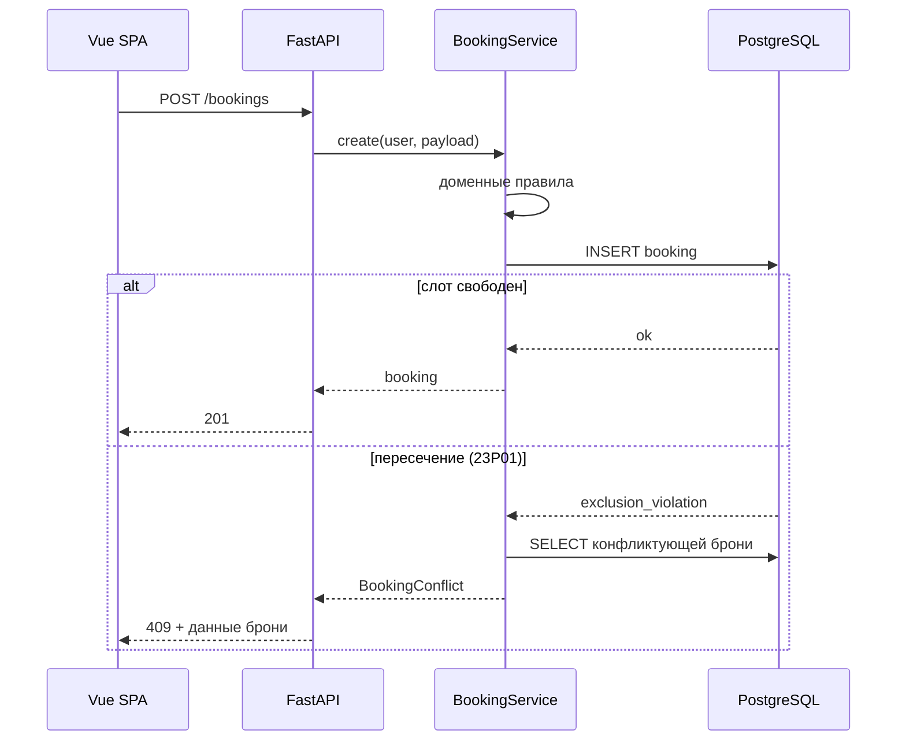

_Рисунок 4 — Создание брони и конфликт_

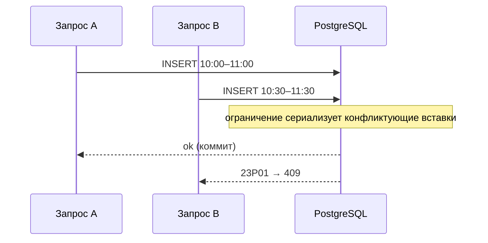

_Рисунок 5 — Гонка двух запросов_

Правила, зависящие от часового пояса или от текущего момента (рабочие часы, «не в прошлом», правила изменения начавшейся брони), проверяются в доменном слое — до обращения к БД, с понятными кодами ошибок.

### 2.4. API

REST API с префиксом `/api/v1` включает около 30 эндпоинтов в шести группах: аутентификация, пользователи, комнаты и оборудование, брони, уведомления, статистика. Время передаётся в ISO 8601 со смещением; значения без смещения отклоняются.

Отмена брони реализована как `POST /bookings/{id}/cancel`, а не `DELETE`: это переход состояния, запись сохраняется.

Все ошибки имеют единый формат `{ "error": { "code", "message", "details" } }`. Машиночитаемый `code` позволяет фронтенду подсветить нужное поле, а `details` при конфликте содержит пересекающуюся бронь:

| HTTP | Примеры кодов | Ситуация |
|---|---|---|
| 401 | `INVALID_CREDENTIALS`, `UNAUTHENTICATED` | Неверные данные входа, нет или истёк токен |
| 403 | `FORBIDDEN`, `ACCOUNT_DISABLED` | Нет прав, пользователь заблокирован |
| 409 | `BOOKING_CONFLICT`, `SELF_LOCKOUT` | Пересечение броней, конфликт справочников |
| 422 | `INVALID_DURATION`, `OUTSIDE_WORKING_HOURS`, `BOOKING_IN_PAST`, `CAPACITY_EXCEEDED` | Нарушение бизнес-правил |
| 429 | `TOO_MANY_ATTEMPTS` | Превышен лимит попыток входа |

### 2.5. Безопасность

| Аспект | Решение |
|---|---|
| Пароли | Хеш argon2id |
| Access-токен | JWT, 15 минут; на клиенте хранится только в памяти, не в `localStorage` |
| Refresh-токен | JWT с идентификатором `jti`, 7 дней, httpOnly cookie; ротация при каждом обновлении, отзыв при выходе |
| Блокировка | Пользователь загружается из БД на каждом запросе, поэтому блокировка действует сразу, а не после истечения токена |
| Подбор пароля | После 5 неверных попыток вход блокируется на 15 минут; счётчик хранится в БД |
| Права | Зависимости FastAPI `current_user` и `require_admin`; владелец брони проверяется в сервисе |

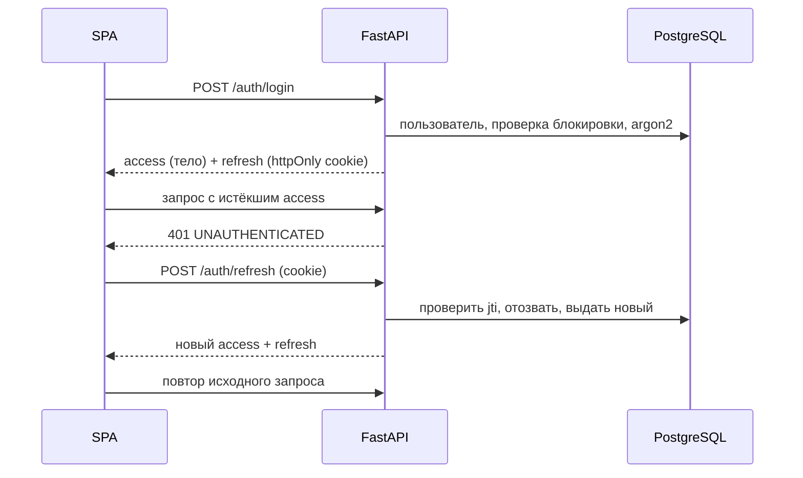

_Рисунок 6 — Вход и обновление токена_

### 2.6. Алгоритмы

**Пересечение интервалов.** Два полуоткрытых интервала пересекаются, если `a.start < b.end и b.start < a.end`. Эта функция — эталон для модульных тестов; в БД то же условие задаёт оператор `&&`.

**Поиск свободных комнат.** Один SQL-запрос отбирает активные комнаты нужной вместимости, для которых не существует активной брони, пересекающей интервал, и которые содержат всё выбранное оборудование. Подзапрос `NOT EXISTS` обслуживается тем же GiST-индексом, что и ограничение исключения. Результат упорядочен по вместимости, чтобы первыми шли наиболее подходящие комнаты.

**Статистика.** Период задаётся локальными датами организации и переводится в UTC. Загрузка комнаты — отношение занятых минут к доступным (`720 минут × число дней`); занятые минуты — сумма пересечений активных броней с периодом. Пиковые часы строятся разворачиванием каждой брони в часовые слоты (`generate_series`) в локальной зоне: результат — матрица «день недели × час». По пользователям считаются число броней, часы, доля отмен.

**Часовые пояса.** В БД и в домене используются только datetime с часовым поясом в UTC. Зона организации (`ORG_TIMEZONE`, по умолчанию `Europe/Moscow`) применяется в трёх местах: проверка рабочих часов, статистика, текст уведомлений. Фронтенд показывает время в зоне организации, а не браузера, чтобы все пользователи видели одинаковую сетку.

### 2.7. Уведомления и планировщик

Уведомления трёх типов — напоминание за 15 минут, изменение и отмена брони другим пользователем — хранятся в БД. Клиент опрашивает счётчик непрочитанных раз в 30 секунд; WebSocket не потребовался, так как задержка в полминуты для этих событий приемлема.

Напоминания создаёт фоновая задача `asyncio`, запускаемая при старте приложения. Раз в 30 секунд она выполняет один идемпотентный запрос `INSERT … SELECT … ON CONFLICT (dedupe_key) DO NOTHING`. Ключ дедупликации составлен из идентификатора брони и момента её начала. Поэтому повторный тик, перезапуск сервиса и даже несколько экземпляров не создают дублей (NFR-6), а перенос брони даёт новый ключ и новое напоминание (BR-11). Отменённые брони в выборку не попадают.

Уведомления об изменении и отмене создаются в той же транзакции, что и само действие, и только если действие выполнил не организатор (BR-12).

### 2.8. Интерфейс

| Маршрут | Экран | Роль |
|---|---|---|
| `/login` | Вход | все |
| `/` | Календарь «комнаты × день» | все |
| `/rooms`, `/rooms/:id` | Список комнат; комната с календарём на неделю | все |
| `/search` | Поиск свободных комнат | все |
| `/my` | Мои брони: предстоящие, прошедшие, отменённые | все |
| `/admin` | Комнаты, оборудование, пользователи | администратор |
| `/stats` | Статистика и экспорт CSV | администратор |

Снимки экранов приведены в приложении Б.

Главный экран — календарная сетка: колонки соответствуют комнатам, строки — 15-минутным слотам с 08:00 до 20:00. Выделение свободных ячеек открывает форму брони с предзаполненными комнатой и временем; клик по своей брони открывает её для изменения. Прошедшее время затемнено и недоступно для выбора.

Готовые компоненты календарей (например, FullCalendar) не использовались: нужный ресурсный вид в FullCalendar доступен только в платной версии, а требуемая сетка «колонки × 15 минут» реализуется собственным компонентом на CSS Grid.

## 3. Реализация

### 3.1. Структура проекта

Проект состоит из двух кодовых баз в одном репозитории и файла `docker-compose.yml` для PostgreSQL:

```
backend/    # FastAPI: app/{api,services,domain,core}, миграции alembic/, тесты tests/
frontend/   # Vue 3: src/{api,pages,components,stores,router,utils}
docs/       # требования, проектирование, тестирование, отчёт
PLAN.md     # план работ и прогресс
```

Разработка велась итеративно по плану `PLAN.md`: подготовка, требования, проектирование, реализация, тестирование, отчёт. История изменений ведётся в git короткими тематическими коммитами (Conventional Commits).

### 3.2. Бэкенд

**Модели и миграции.** Модели описаны в SQLAlchemy 2 с аннотациями типов. Все столбцы времени объявлены как `DateTime(timezone=True)` — без этого SQLAlchemy создаёт `timestamp without time zone`. Ограничение исключения задаётся через `ExcludeConstraint` и попадает в миграцию Alembic автоматически; создание расширения `btree_gist` добавлено в миграцию вручную.

**Доменные правила** (`domain/rules.py`) — набор чистых функций: `overlaps`, проверка интервала (порядок, длительность, кратность 15 минутам, рабочие часы в зоне организации), «не в прошлом», вместимость, возможность изменения. Каждая функция при нарушении бросает `RuleViolation` с кодом и сообщением на русском языке, которые обработчик превращает в ответ 422.

**Сервис броней** (`services/bookings.py`). Создание: проверка правил → проверка комнаты (существует, активна, вместимость) → `INSERT` → обработка `IntegrityError` с SQLSTATE `23P01` → ответ 409 с конфликтующей бронью. Изменение начинается с `SELECT … FOR UPDATE`, затем проверяются права и правила изменения начавшейся или завершённой брони, после чего повторяются проверки создания. Сама бронь себя не блокирует: при `UPDATE` ограничение не сравнивает строку с ней же. Отмена меняет статус и сохраняет, кто и когда отменил.

**Аутентификация** (`services/auth.py`): вход с подсчётом неудачных попыток, выдача пары токенов, ротация refresh-токена с записью в `refresh_tokens`, отзыв всех refresh-токенов пользователя при смене и сбросе пароля.

**Статистика** (`services/stats.py`) реализована четырьмя SQL-запросами (загрузка комнат, пиковые часы, пользователи, сводка); вычисления выполняет СУБД. Экспорт в CSV использует разделитель `;` и BOM для корректного открытия в Excel.

**Планировщик** (`scheduler.py`) — цикл `asyncio`, выполняющий тик в отдельном потоке; исключение в тике логируется и не останавливает цикл.

**Начальные данные** (`app.seed`) — идемпотентный сид: администратор, сотрудники, пять комнат разной вместимости и справочник оборудования.

### 3.3. Фронтенд

SPA построено на Vue 3 (Composition API) и TypeScript. Основные элементы:

- `api/client.ts` — типизированный клиент `openapi-fetch`. При ответе 401 клиент обновляет access-токен по refresh-cookie и повторяет исходный запрос; параллельные запросы используют одно общее обновление, поскольку ротация токена не допускает двойного использования.
- `stores/auth.ts` — хранилище Pinia с текущим пользователем; токен хранится только в памяти.
- `router/` — маршруты и guard: неавторизованный пользователь перенаправляется на вход, сотрудник — с административных страниц на главную.
- `components/CalendarGrid.vue` — календарная сетка на CSS Grid; один компонент обслуживает и вид «комнаты × день», и вид «комната × неделя».
- `components/BookingForm.vue` — форма брони; ошибки сервера подсвечивают соответствующее поле, конфликт 409 показывается блоком с темой, временем и организатором занятой брони.
- `components/NotificationBell.vue` — колокольчик с опросом раз в 30 секунд.
- `utils/time.ts` — единственный модуль работы с часовыми поясами (на основе `Intl.DateTimeFormat`).

Интерфейс оформлен по единой дизайн-системе: токены цвета и отступов в CSS-переменных, шрифты Onest и JetBrains Mono, иконки lucide; на узких экранах навигация переносится в нижний таб-бар.

Клиентские проверки только подсказывают пользователю; окончательное решение всегда принимает сервер (NFR-9).

### 3.4. Генерация типов из OpenAPI

FastAPI строит OpenAPI-схему по моделям Pydantic. Скрипт `npm run gen:api` получает схему из приложения без запуска сервера и генерирует `src/api/schema.d.ts` с помощью `openapi-typescript`. Все вызовы API на фронтенде типизированы этой схемой, поэтому изменение контракта на бэкенде, не отражённое на фронтенде, приводит к ошибке компиляции `vue-tsc` при сборке (NFR-11).

## 4. Тестирование

Описание тестов и результаты — `docs/04-testing.md`.

### 4.1. Стратегия и уровни тестов

| Уровень | Что проверяется | Окружение |
|---|---|---|
| Модульные | `overlaps` (встык, совпадающие, вложенные, частичные), длительность, шаг 15 минут, рабочие часы в зоне организации, «не в прошлом», вместимость, правила изменения | Без БД |
| Ограничения БД | `23P01` при пересечении; встык и отменённая бронь допустимы; `23514` при неверной длительности | PostgreSQL |
| Интеграционные (API) | Создание, конфликт 409, изменение, отмена, права, календарь, «мои брони», поиск, уведомления, статистика, аутентификация | PostgreSQL + TestClient |
| Гонки | Параллельные брони одного слота | PostgreSQL, два соединения |
| Фронтенд | Утилиты времени и часовых поясов | Vitest |

Интеграционные тесты работают с реальной PostgreSQL, а не с подменой: проверяемое поведение (ограничение исключения, коды ошибок) существует только в настоящей СУБД. Тесты используют отдельную базу `<имя>_test`, которая создаётся и мигрируется автоматически. Каждый тест выполняется во внешней транзакции с откатом, поэтому тесты не влияют друг на друга. Правила зависят от текущего момента, поэтому «сейчас» в тестах броней зафиксировано на полдень — иначе прогон ночью давал ложные падения.

### 4.2. Проверка гонок

Тест `test_race.py` воспроизводит ситуацию, когда два пользователя одновременно бронируют один слот. Два потока с отдельными соединениями синхронизируются барьером и одновременно вызывают создание брони; транзакции фиксируются по-настоящему. Проверка повторяется на пяти слотах. Во всех случаях ровно один запрос успешен, второй получает `BOOKING_CONFLICT`. На этапе проектирования аналогичная проверка с 8 потоками на один слот дала 1 успешную вставку и 7 ошибок `23P01`.

### 4.3. Результаты приёмки

Прогон 02.10.2026: PostgreSQL 16 в Docker; бэкенд — 65 тестов пройдено, фронтенд — 6 тестов пройдено.

| # | Сценарий | Результат |
|---|---|---|
| AC-1 | Брони 10:00–11:00 и 10:30–11:30 в одной комнате | ✔ 409, в ответе первая бронь |
| AC-2 | 10:00–11:00 и 11:00–12:00 в одной комнате | ✔ обе приняты |
| AC-3 | Те же интервалы в разных комнатах | ✔ обе приняты |
| AC-4 | Изменение без смены времени | ✔ успех |
| AC-5 | Отмена и новая бронь на тот же слот | ✔ новая принята |
| AC-6 | Два параллельных запроса на слот | ✔ один успех, один 409 |
| AC-7 | Поиск на 10:00–11:00 | ✔ занятые и малые комнаты исключены |
| AC-8 | Сотрудник меняет чужую бронь | ✔ 403; администратор — успех |
| AC-9 | 07:45–08:45, 19:45–20:15, 5 минут, 9 часов | ✔ все отклонены с 422 и причиной |
| AC-10 | Бронь в прошлом | ✔ 422 |
| AC-11 | Участников больше вместимости | ✔ 422 |
| AC-12 | Бронь стартует через 15 минут | ✔ ровно одно напоминание |
| AC-13 | Администратор отменил чужую бронь | ✔ уведомление организатору; при своей отмене — нет |
| AC-14 | Вход заблокированного пользователя | ✔ 403 |
| AC-15 | Сотрудник открывает статистику | ✔ 403 |
| AC-16 | 6 часов брони при 12-часовом рабочем дне | ✔ загрузка 50% |
| AC-17 | Клик по свободному слоту в календаре | ✔ форма с комнатой и временем слота (проверено вручную) |

Критерии AC-1…AC-16 проверяются автотестами, AC-17 — вручную в браузере. Выполнено 17 из 17 критериев.

В ходе тестирования найдена и исправлена ошибка: в статистике комнаты без броней получали в `booked_minutes` всю длительность периода (функции `least`/`greatest` в PostgreSQL пропускают `NULL`, и левое соединение без броней давало длительность всего периода). После исправления добавлена проверка, что у таких комнат загрузка равна нулю.

## Заключение

В работе спроектирован и реализован прототип системы бронирования переговорных комнат.

1. Собраны и формализованы требования: 17 пользовательских сценариев, 28 функциональных и 11 нефункциональных требований, 13 бизнес-правил, 17 критериев приёмки с матрицей трассируемости.
2. Спроектированы архитектура, модель данных, API и интерфейс; ключевые риски (поведение ограничения исключения, гонки, генерация миграций, идемпотентность напоминаний) проверены на реальной PostgreSQL до начала реализации.
3. Реализованы REST API на FastAPI и SPA на Vue 3 с ролевой моделью, календарём, поиском свободных комнат, уведомлениями и статистикой.
4. Система покрыта автотестами на всех уровнях, включая тест гонки; все критерии приёмки выполнены.

Основной результат — гарантия отсутствия пересечений, перенесённая с уровня приложения на уровень СУБД. Ограничение исключения PostgreSQL одновременно служит проверкой и защитой от гонок; приложению остаётся лишь перевести ошибку `23P01` в понятный пользователю ответ.

**Ограничения прототипа:** часть вопросов к автору кейса осталась без ответа, система работает на допущениях (плоский список помещений, один часовой пояс, все дни рабочие); выбор слота в календаре выполняется мышью; нагрузочное тестирование не проводилось; переход на летнее время не проверялся.

**Направления развития:** иерархия помещений (здания, этажи); повторяющиеся встречи; уведомления по email и в мессенджерах; экспорт в .ics и интеграция с внешними календарями; push-уведомления через WebSocket или SSE вместо опроса; согласование броней для отдельных комнат.

## Список использованных источников

1. FastAPI : документация. — URL: https://fastapi.tiangolo.com/
2. SQLAlchemy 2.0 Documentation. — URL: https://docs.sqlalchemy.org/en/20/
3. Alembic Documentation. — URL: https://alembic.sqlalchemy.org/
4. PostgreSQL 16 Documentation. Constraints: Exclusion Constraints. — URL: https://www.postgresql.org/docs/16/ddl-constraints.html#DDL-CONSTRAINTS-EXCLUSION
5. PostgreSQL 16 Documentation. Range Types. — URL: https://www.postgresql.org/docs/16/rangetypes.html
6. PostgreSQL 16 Documentation. btree_gist. — URL: https://www.postgresql.org/docs/16/btree-gist.html
7. Pydantic Documentation. — URL: https://docs.pydantic.dev/
8. Vue.js : документация. — URL: https://vuejs.org/
9. Vite Documentation. — URL: https://vite.dev/
10. openapi-typescript / openapi-fetch. — URL: https://openapi-ts.dev/
11. OpenAPI Specification 3.1.0. — URL: https://spec.openapis.org/oas/v3.1.0
12. RFC 7519. JSON Web Token (JWT). — URL: https://www.rfc-editor.org/rfc/rfc7519
13. RFC 9106. Argon2 Memory-Hard Function for Password Hashing. — URL: https://www.rfc-editor.org/rfc/rfc9106
14. ISO 8601-1:2019. Date and time — Representations for information interchange.

## Приложение А. Инструкция пользователя

_Ссылка на раздел README после его написания._

## Приложение Б. Интерфейс

Снимки сделаны в Chrome (1280 × 860) на демонстрационных данных.

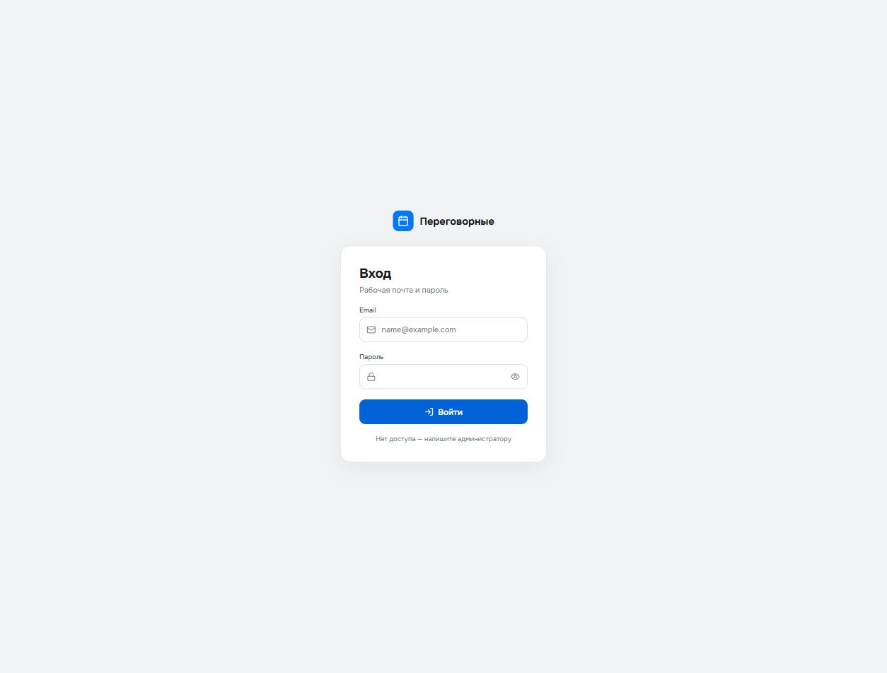

_Рисунок Б.1 — Вход_

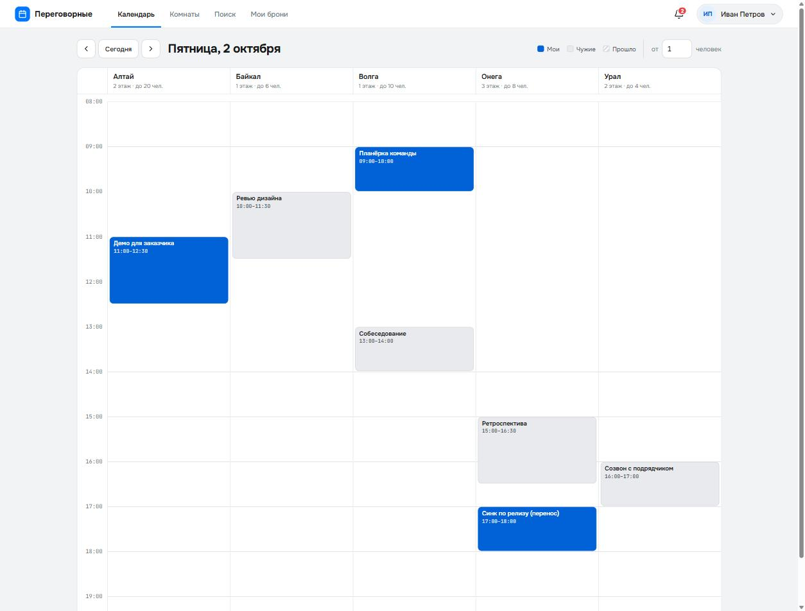

_Рисунок Б.2 — Главный экран: календарь «комнаты × день»_

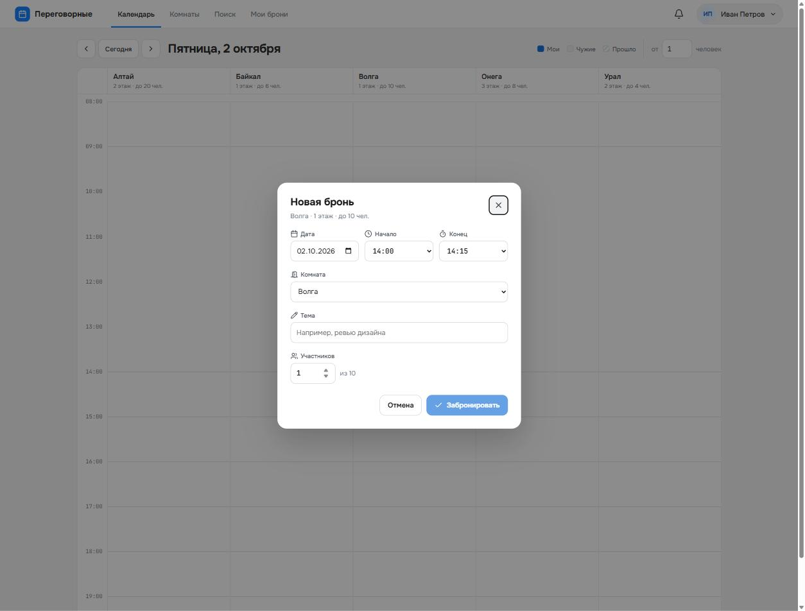

_Рисунок Б.3 — Форма новой брони после выбора слота в календаре_

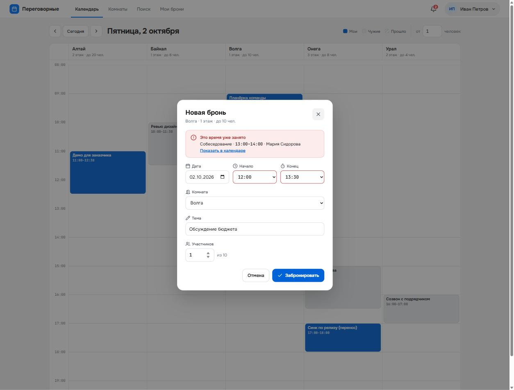

_Рисунок Б.4 — Ответ 409: слот занят, показана конфликтующая бронь_

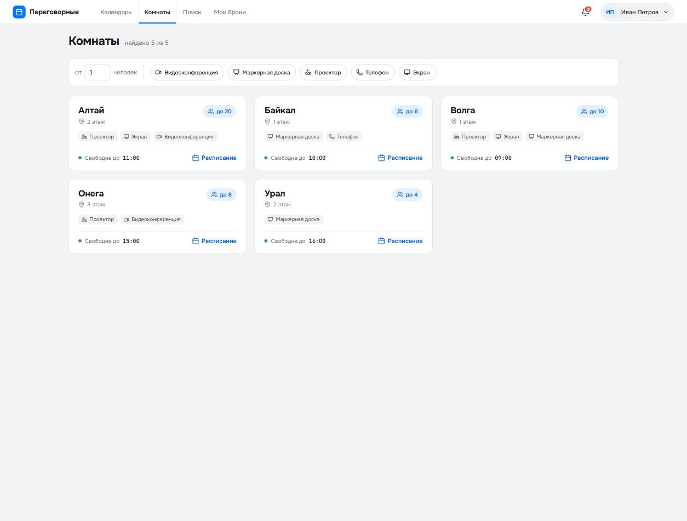

_Рисунок Б.5 — Список комнат_

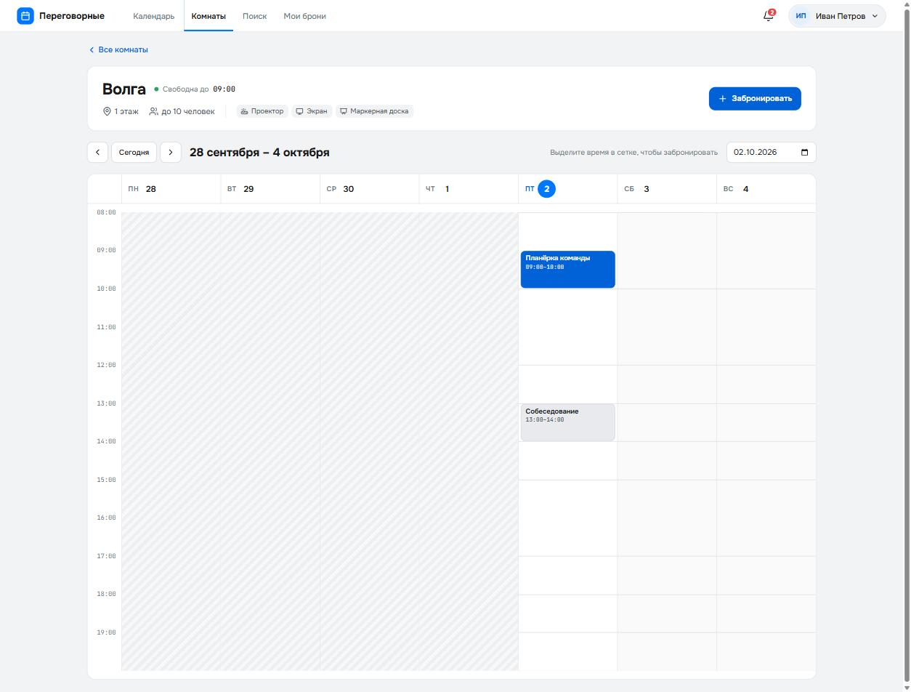

_Рисунок Б.6 — Комната: календарь на неделю_

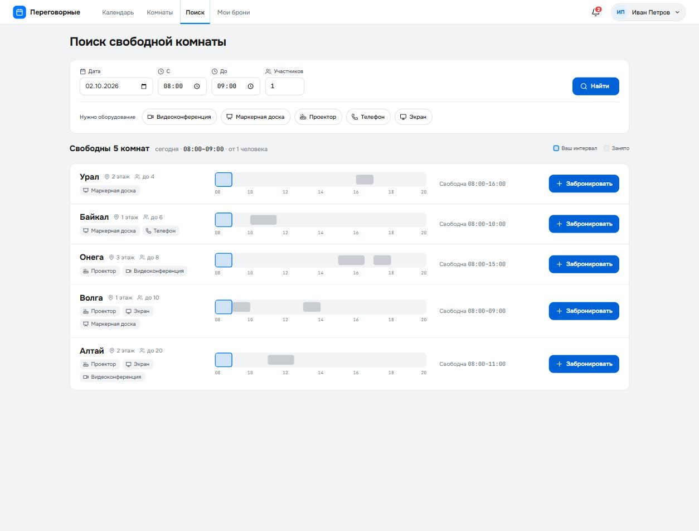

_Рисунок Б.7 — Поиск свободных комнат_

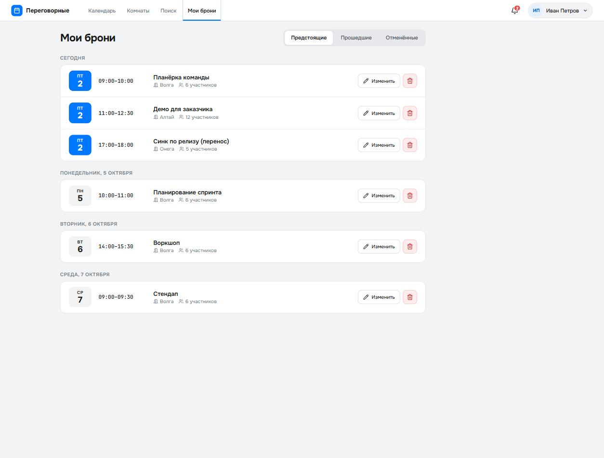

_Рисунок Б.8 — Мои брони_

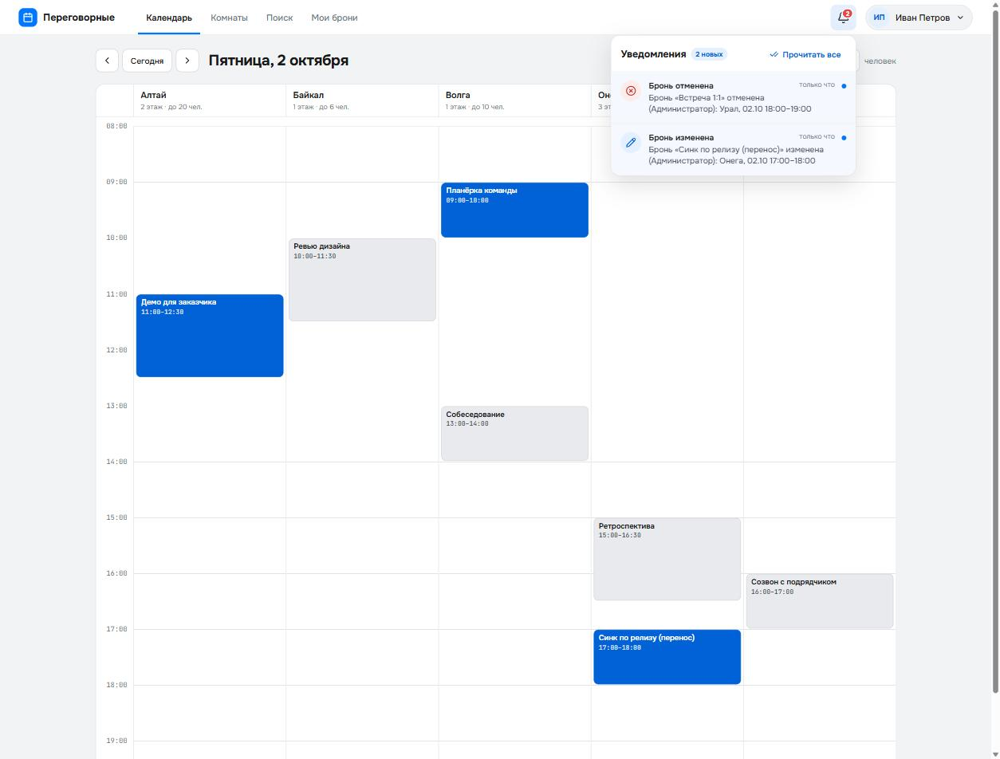

_Рисунок Б.9 — Уведомления об изменении и отмене брони администратором_

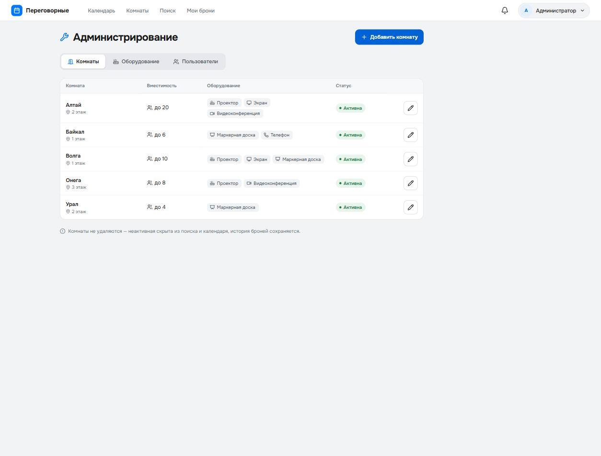

_Рисунок Б.10 — Администрирование: комнаты_

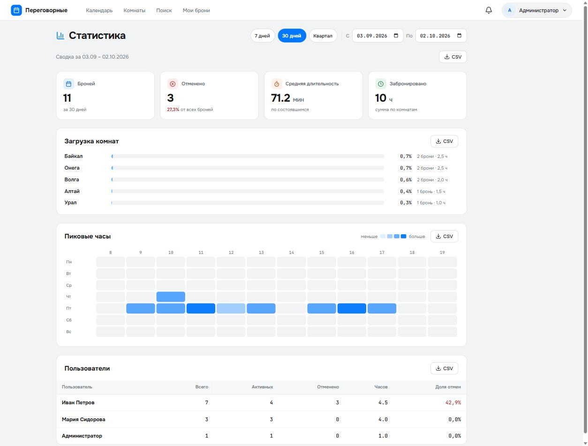

_Рисунок Б.11 — Статистика_
